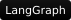

# Hi, I'm Sashi

I'm an AI and Software Engineer based in the San Francisco Bay Area. I build practical AI systems, backend services, and automations that reduce manual work, with a focus on AI agents, RAG, and voice applications.

I earned my master's degree in Computer Science from the University at Buffalo, where I focused on Artificial Intelligence, after completing my undergraduate degree in Computer Science and Engineering in India.

Outside of tech, I love cinema. I'm currently looking for **full-time Software and AI Engineering opportunities**.

